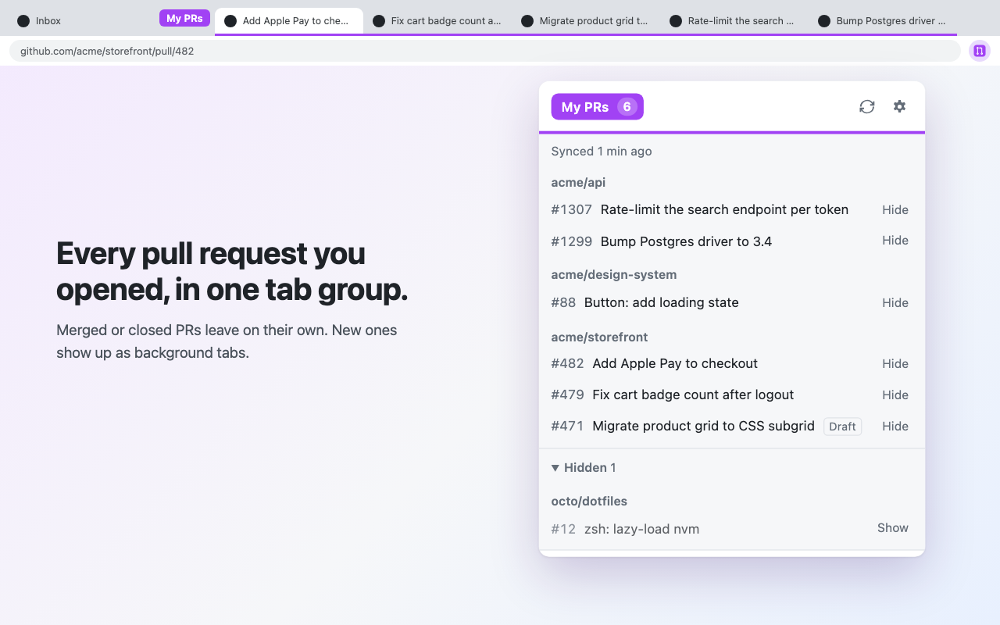

# My PRs Tab Group

A Chrome extension that keeps one tab group filled with every open GitHub pull request and GitLab merge request you authored.



## Install

**Chrome Web Store:** *listing in review, link coming soon.*

### From source

```sh
git clone https://github.com/AdamSiekierski/chrome-my-prs.git
```

1. Open `chrome://extensions` and turn on **Developer mode**.
2. **Load unpacked** → pick the `chrome-my-prs` folder. The settings page opens on first install.
3. [Create a classic token with `repo` scope](https://github.com/settings/tokens/new?scopes=repo&description=My%20PRs%20Tab%20Group),
   paste it, press **Check token**, then **Save changes**.

To update: `git pull`, then press the reload icon on the extension's card in `chrome://extensions`.

A token reaches every repo you can, so it's the recommended way. A
[fine-grained token](https://github.com/settings/personal-access-tokens/new) works too: Pull requests + Metadata
read-only on the repos you work in. If your org enforces SAML SSO, authorize the token for it, or those PRs
silently won't appear in search.

Alternatively, **Sign in with GitHub** skips the token: approve a code on github.com and you're done. But orgs
that restrict third-party apps hide their PRs until an org owner approves the app; the popup warns when that happens.

### GitLab

In settings, under **GitLab instances**, add each GitLab you use (`https://gitlab.com` and/or self-hosted ones), each
with its own personal access token with the `read_api` scope. On save, Chrome asks to allow access to those instances,
and gives access back for ones you remove. GitHub and GitLab are independent; set up any combination.

## How it behaves

- Every N minutes (default 5) it runs one GitHub search: `is:pr is:open author:@me archived:false`
  plus your optional extra filter (e.g. `org:my-company`). Each GitLab instance adds one
  `GET /api/v4/merge_requests?scope=created_by_me&state=opened` (the extra filter doesn't apply to it).
- Missing PRs get opened as background tabs in the group; merged, closed and hidden ones get closed.
- **One group per repository** (off by default, in settings): each repo gets a group named `<group name>: <repo>`,
  created with its first PR and gone once its last PR tab closes.
- **Hide**: the Hide button in the popup, or right-click a PR page/link → *Hide from My PRs group*.
  Hides sync across machines through your Chrome account and are forgotten 30 days after the PR closes.
- Clicking a PR in the popup jumps to its tab; clicking the group label opens the group.
- Opening a PR that already has a tab in the group (a link, a bookmark, typing the URL) switches to that tab instead of
  duplicating it. A new tab closes; a tab you followed a link in goes back to where it was.

### Deliberate choices

- **A failed fetch never closes tabs.** A network blip or expired token must not read as "you have no PRs".
  With several sources set up, any one failing skips the whole sync.
- **The active tab is never closed.** A PR you just merged stays put until you switch away; the next sync removes it.
- **Non-PR tabs inside the group are left alone**, and a tab you navigated within a PR (`/files`, `/commits`) still
  counts as that PR's tab, so no duplicates.
- **Closing a PR tab by hand doesn't hide it**, so it comes back on the next sync. Hide is the explicit way to remove one;
  pausing (the toggle in the popup) stops all changes.
- **The group is found by name after a restart** (Chrome doesn't keep group ids), so keep the name unique.
  Settings are the source of truth: renaming the group in Chrome's UI gets reverted, rename it in settings instead.
- **Tokens stay in `storage.local`**: the GitHub one is sent only to `api.github.com`, each GitLab one only to its own
  instance. Hides go in `storage.sync`.
- **GitLab access is an optional permission**, requested for just the instances you add, so adding GitLab support didn't
  make Chrome disable the extension for existing users.

## Privacy

No server, no analytics. The token stays in this browser and goes only to GitHub. See [PRIVACY.md](PRIVACY.md).

## Releasing

Publishing a GitHub release `vX.Y.Z` ships it to the Chrome Web Store.
Setup and steps: [docs/publishing.md](docs/publishing.md).

## Files

- `background.js`: sync loop, tab group reconciliation, context menu
- `lib/shared.js`: settings, hides, the list of active sources (adapters)
- `lib/github.js`, `lib/gitlab.js`: one adapter per source: fetch your open PRs/MRs, recognize their URLs
- `popup.*`, `options.*`, `ui.css`: UI
- `store/`: Web Store listing text and images

## License

[MIT](LICENSE)
